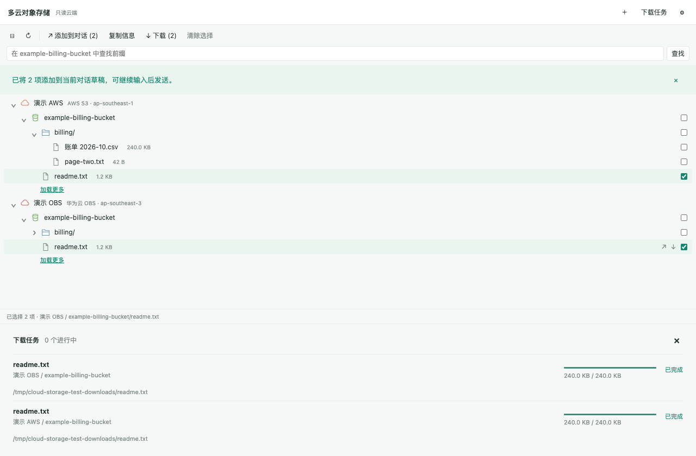

# 多云对象存储 · Codex Cloud Storage

[English](README.en.md) · [Releases](https://github.com/boreas320/codex-cloud-storage/releases)

在 Codex 的 **新标签页 → 更多工具 → 插件和 MCP** 打开多云对象存储浏览器。
统一浏览 AWS S3、华为云 OBS、腾讯云 COS、阿里云 OSS 和 S3 兼容服务，并将指定文件下载到本机。



## 功能

- 紧凑树形浏览：账号 → 桶 → 目录 → 对象；各分支独立展开、按需加载、分页和重试。
- 桶、目录、对象可单项或多选「添加到对话」，追加到当前输入草稿，发送前仍可编辑。
- 多账号、指定桶、前缀查询、刷新和键盘方向键导航。
- 区域按云服务提供中文名称与代码下拉列表，支持自定义区域；校验失败时逐字段说明原因并定位错误。
- 对象元数据，包括大小、修改时间、存储类型和 ETag。
- 单文件、多选文件下载，进度、取消、同名文件自动编号。
- macOS 钥匙串存储凭证；本地服务负责签名和流式传输。
- Codex 标签页入口和对话工具共用同一服务；没有内容预览、云端上传、删除、恢复或复制接口。

## 安装

需要 macOS、支持 MCP Apps thread entrypoint 的新版 Codex Desktop，以及 [uv](https://docs.astral.sh/uv/getting-started/installation/)。开发环境使用 Python 3.12 和 Node.js 22；安装包已包含界面，无需 Node.js。

```sh
codex plugin marketplace add boreas320/codex-cloud-storage --ref v0.2.1
codex plugin add codex-cloud-storage@cloud-storage
```

回到 Codex，打开新标签页，在「更多工具」中选择「多云对象存储」。安装后请先在新聊天中打开插件；安装前已经运行的聊天可能还保留旧工具列表。首次启动由 uv 安装锁定的 Python 依赖，需要网络；之后使用本地缓存。

也可下载 Release ZIP，校验 `SHA256SUMS`，解压后执行附带的安装脚本（需已安装 uv 和 Codex CLI）：

```sh
sh codex-cloud-storage/scripts/install-local.sh
```

脚本注册解压目录为本地 marketplace，然后通过 Codex 官方命令安装。请保留解压目录，供后续重装使用。

## 添加账号

点击「添加账号」，选择云服务和区域，填写名称、可选服务地址，以及访问密钥；临时凭证可填写 session token。请在界面录入密钥，不要粘贴到聊天中。

| 服务 | 地域与地址示例 |
|---|---|
| AWS S3 | `ap-southeast-1`；服务地址通常留空 |
| 华为 OBS | `https://obs.ap-southeast-3.myhuaweicloud.com`；必须填写服务地址 |
| 腾讯 COS | `ap-singapore`；桶名应包含账号 APPID 后缀 |
| 阿里 OSS | `cn-hangzhou`；服务地址通常留空 |
| MinIO / S3 兼容 | 自定义 HTTPS 服务地址，必要时勾选路径寻址；本机测试允许 HTTP loopback |

账号应有列举桶/对象与读取对象权限。若账号没有列举全部桶的权限，在「指定存储桶」中每行填写一个桶名。此列表是浏览入口，不代替云端权限控制。

账号元数据保存到 macOS Application Support 的 `codex-cloud-storage/config.json`；密钥仅保存到钥匙串服务 `io.github.boreas320.codex-cloud-storage`。钥匙串不可用时保存失败，不会降级到明文文件。更新凭证需填写完整密钥和临时令牌；全部留空保留原凭证。

## 树形浏览与添加到对话

点击账号、桶或目录展开下一级；各分支下方的「加载更多」只加载该分支下一页。对象点击后显示元数据。方向键上下移动、左右展开/折叠，空格切换选择。右侧勾选框可跨账号选择多个条目；只有文件可下载。

选中桶、目录或对象，点击工具栏「添加到对话」，或使用该行的 ↗ 按钮。每项作为带标题的上下文附件添加到当前聊天草稿，不自动发送、不替换已有输入；连续添加会保留已有附件，相同信息自动去重。仅包含账号标识、云类型、区域、桶、完整对象键或前缀，以及已读取的对象大小、修改时间、存储类型和 ETag。不会递归枚举子目录、读取正文或附带密钥，当前插件的草稿附件合计最多 100 项。

通过 Codex 的 MCP Extensions 上下文接口更新附件，并与浏览位置保存串行协调。宿主不支持或添加失败时自动打开「复制信息」弹窗，保留所选账号和完整路径，支持重试。工具栏也可直接打开「复制信息」；系统不允许自动复制时会选中文本，提示手动复制。

## 下载与边界

默认目录是 `~/Downloads/多云对象存储`，可在插件设置中更改。最多 3 个并行下载、100 个排队任务；同名文件添加序号。

下载先写隐藏临时文件，校验大小和下载前后 ETag，完成后原子地生成目标文件。下载结果附带本地 SHA-256；ETag 作为版本标识，不冒充 MD5。服务端提供的完整对象校验值可用时会校验。读取归档对象失败时提示用户，不自动发起恢复。

- 不递归下载目录、不支持断点续传；失败后重新下载。
- 任务队列保留在当前服务生命周期中，重启后不恢复任务；账号与下载目录持久保存。浏览位置通过宿主的 model-context 状态接口按聊天恢复，保存展开位置、搜索位置和当前节点（最多恢复 100 个展开分支），不含密钥或文件内容。宿主不支持该接口时，仅保留当前标签页中的位置。
- 强制终止进程可能留下 `.cloud-download-*.part`；可确认无下载运行后手动删除。正常失败/取消会清理临时文件。
- 文件内容直接从云端传到本机，不进入模型上下文。账号表单通过宿主的 app-only 工具通道提交；这不表示凭证对宿主进程不可见。
- 仅支持当前对象，不提供历史版本、归档恢复和客户提供加密密钥的对象下载。

## 对话工具

`storage.open`、`list_accounts`、`list_buckets`、`list_objects`、`head_object`、`start_download`、`get_download_status`、`cancel_download`。

账号设置和下载设置工具仅供界面调用。云端操作只读；下载与配置会写入本地磁盘。

## 开发与验证

```sh
uv sync --python 3.12
cd frontend
npm ci
npm run build
npx playwright install chromium
npm test
cd ..
uv run ruff check src tests
uv run python -m pytest -q
uv run python scripts/package.py
```

若本机已有 Chrome，可使用 `PLAYWRIGHT_CHANNEL=chrome npm test`。测试数据全部为合成数据，`CLOUD_STORAGE_DATA_DIR` 可隔离测试配置。测试不会自动接入你的云账号。

详见 [验证记录与限制](docs/verification.md)。AWS/S3 的模拟集成测试以及 OBS/COS/OSS 的适配器测试，**不等同于真实云连接验证**。

## 开源说明

Apache-2.0。本项目是独立实现，参考 Storage UI、BucketDock 和 mcp-server-opendal 的产品能力，以及 OpenAI MCP Extensions 官方协议；没有复制这些项目的业务源码。依赖及致谢见 [NOTICE](NOTICE)。

## 安装后显示「未能显示」

如果菜单入口存在，但页面报错，先在**新聊天**中打开插件。旧聊天在安装插件前已初始化时，可能没有对应的 MCP 服务；这时日志会显示 `unknown MCP server 'cloud-storage'`，插件界面尚未加载，反复点击原标签页的「重试」不会新增服务。也可重启 Codex 后重新打开聊天。

若新聊天仍失败，检查 Codex 日志中的具体错误；不要把密钥或完整账号配置粘贴进问题反馈。安装与协议检查通过不等于实际界面验收通过。

区域预设的官方来源与覆盖范围见 [区域列表说明](docs/regions.md)。
