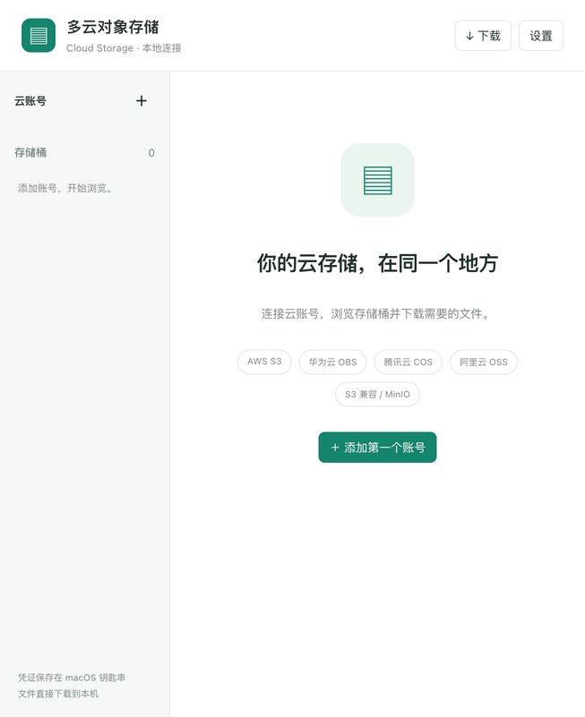
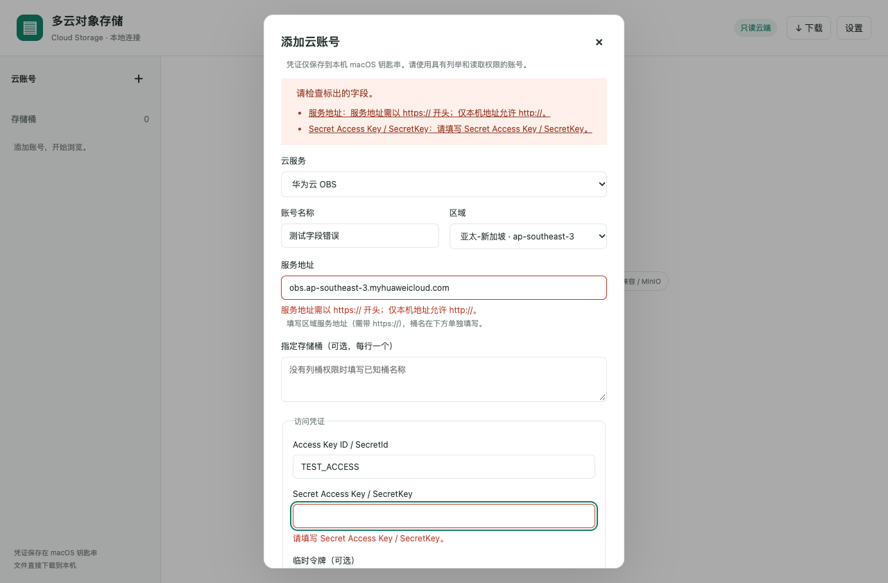

# Verification record — v0.1.0

Date: 2026-10-22 (Asia/Shanghai).

| Check | Evidence / status |
|---|---|
| Python backend and stdio protocol | 32 tests passed locally: S3 SDK with Moto, OBS/COS/OSS response shapes, pagination, special keys, config isolation, failures, cancellation, checksum mismatch, no-overwrite finalization, MCP handshake and UI resource |
| Browser interaction | 4 Playwright tests passed using a real Chromium-family browser and a simulated MCP host: account form, navigation, prefix search, metadata, explicit download, narrow layout, account switching isolation, dark theme, and host-backed navigation restoration |
| UI build | TypeScript check and single-file production build passed |
| Runtime dependencies | Locked in uv.lock and package-lock.json; npm production audit reported no vulnerabilities |
| Real macOS Keychain | Synthetic credential saved, read back using a fresh vault instance, and deleted successfully; no real cloud credentials used |
| Local Codex installation | `codex plugin add` succeeded; read-back reports installed and enabled |
| Installed package startup | Both the GitHub-tag-installed plugin and independently downloaded/extracted release completed MCP initialize, listed 11 tools, opened storage.open with empty arguments, and returned HTML matching the packaged resource byte-for-byte |
| GitHub publication | Public repository and v0.1.0 release published; ZIP and SHA256SUMS downloaded again and verified. GitHub Actions run 39757466064 passed |
| Codex menu and actual rendering | Entry discovered by the user. In a fresh Codex chat, storage.open succeeded and the real MCP Apps page and screenshot were inspected: the onboarding UI renders correctly. See codex-live-ui.png. Pre-install chats can fail with `unknown MCP server 'cloud-storage'`; open a new chat or restart Codex. |
| AWS S3 live account | Not tested — no account supplied for this project |
| Huawei OBS live account | Not tested — no account supplied for this project |
| Tencent COS live account | Not tested — no account supplied for this project |
| Alibaba OSS live account | Not tested — no account supplied for this project |
| MinIO live service | Not tested — S3-compatible transport covered by SDK/mocked service tests only |

`browser-example.png` shows **synthetic test data**, not a production cloud bucket or proof of a live cloud download.

To complete real-account acceptance: open the plugin from More tools, add a read-only account in the UI, browse a known bucket, download a known file, compare its hash with a trusted copy, then reopen the app to confirm account settings persist. Repeat for each provider. Do not publish keys, account configuration, or actual bill files as test evidence.

GitHub Actions is the source of truth for remote test/package status. Release assets include SHA256SUMS for verifying the delivered archive.

Post-release acceptance: actual rendering was verified after v0.1.0 assets were built. The archive retains the build-time verification snapshot; this document and release notes contain the later evidence. No application code changed.

## v0.1.1 — field validation and region selector

- 41 Python tests and 7 Playwright interaction tests passed locally.
- Regression cases cover missing HTTPS, OBS bucket URLs, malformed endpoint ports/paths, required fields, malformed secret fields without echoing submitted secrets, provider-specific region selection, custom-region preservation, and error focus/recovery.
- Screenshot `validation-example.png` uses synthetic inputs with a simulated MCP host. It demonstrates field errors and the region selector, not a live cloud account connection.
- No real account configuration or Keychain entry was read or modified during this update. Fresh Codex rendering evidence above applies to v0.1.0; v0.1.1 UI behavior is tested in a browser harness and its package startup is checked independently.

